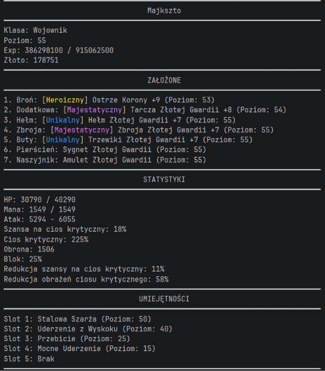
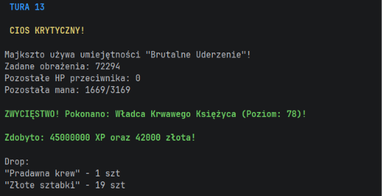
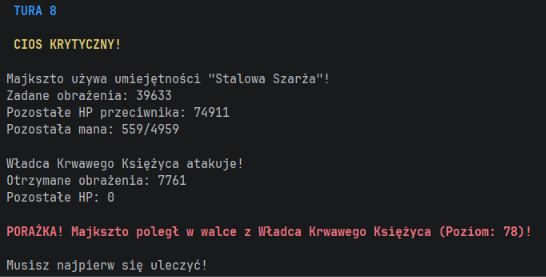
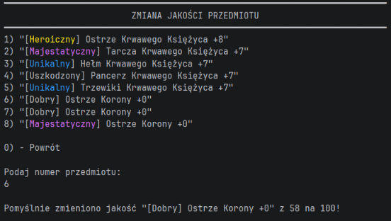
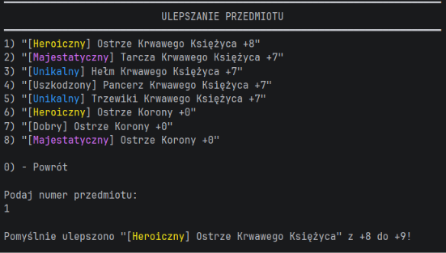
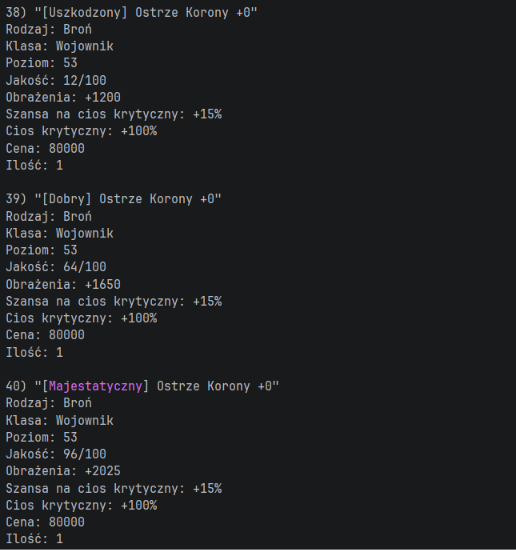
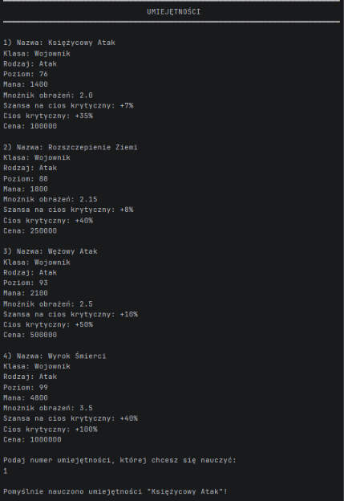
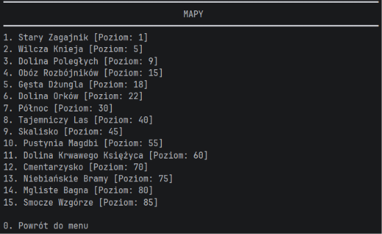
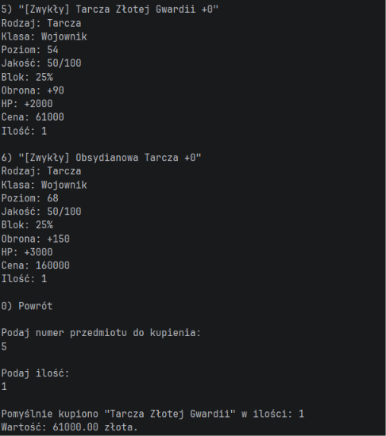
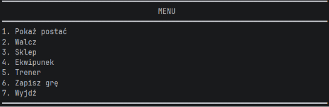

# DEEW RPG

DEEW RPG is a text-based, turn-based RPG developed in Python.

The game features character progression, combat, equipment upgrades, item quality, loot, shops, skills and a JSON save system.

This is my first large personal programming project, built to practice Python, modular code organization and game logic. The project is still in development.


## Gameplay Screenshots

### Character and Equipment


### Combat



### Item Quality and Upgrades



### Item Quality Comparison


### Skills and Locations



### Shop


### Main Menu



## Features

- Turn-based combat with enemies and bosses
- Player leveling and experience points
- Character stats, including HP, mana, attack and defense
- Skills with mana costs and level requirements
- Weapons, armor and equipment bonuses
- Item quality and equipment upgrades
- Different locations and enemies
- Random item drops and inventory
- Shops for buying and selling items
- Health potions
- Saving and loading game progress using JSON

## Requirements

- Python 3.12 or newer
- No external libraries required

## How to Run

1. Download or clone this repository.
2. Open the project folder.
3. Run the game using:

```bash
python main.py
```

The game uses Polish text in the terminal.

## Tests

The project includes basic automated tests for the main game systems.

To run the tests:

```bash
python test_rpg.py
```

The tests check combat, equipment, shops, skills, potions, item drops and saving/loading game progress.

## Project Structure

| File | Description |
|---|---|
| `main.py` | Starts the game |
| `player.py` | Player stats and leveling |
| `combat.py` | Combat system |
| `equipment.py` | Equipment management |
| `items.py` | Item quality and upgrades |
| `mobs.py` | Enemies and locations |
| `drop.py` | Item drops |
| `shop.py` | Buying and selling |
| `skills.py` | Player skills |
| `potions.py` | Health potions |
| `save.py` | Saving and loading |
| `ui.py` | Terminal menus |
| `test_rpg.py` | Basic automated tests |

## Project Status

**Work in Progress**

The main game systems are implemented, but I plan to continue improving the game, fixing bugs and adding new features.

## About Me

My name is Dawid. I am learning Python and working towards my first job in software development.

DEEW RPG is my first larger programming project. I created it to practice working with functions, dictionaries, lists, loops, modules and game logic.