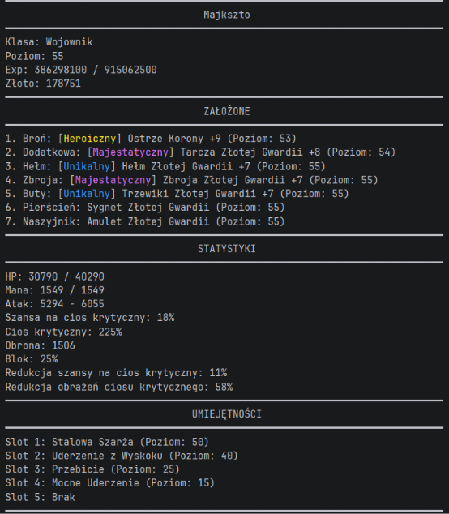
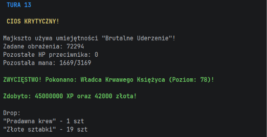
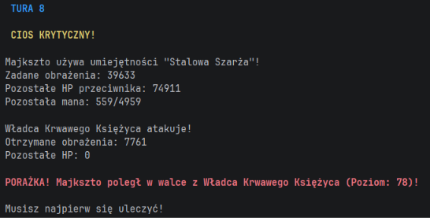
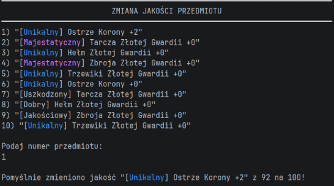
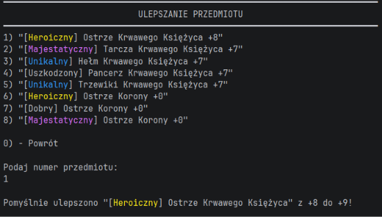
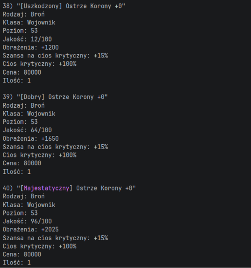
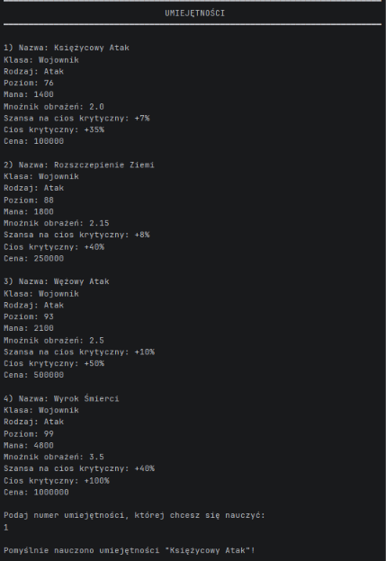
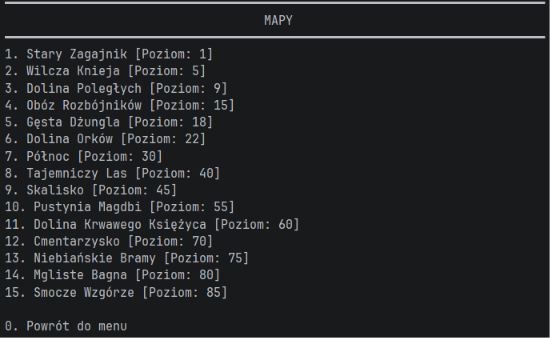
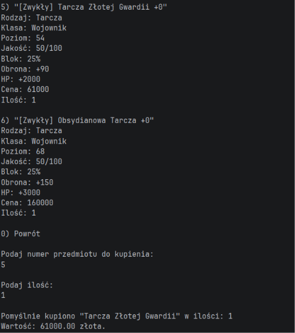
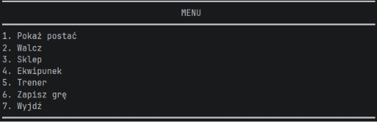

# DEEW RPG

DEEW RPG is a text-based, turn-based RPG developed in Python.

The game features character progression, combat, equipment upgrades, item quality, loot, shops, skills, account registration, authentication and character management using an SQLite database.

This is my first large personal programming project, built to practice Python, modular code organization, game logic, relational databases and automated testing.

The project is actively being developed with the long-term goal of becoming an online, browser-based RPG.


## Gameplay Screenshots

### Character and Equipment


### Combat



### Item Quality and Upgrades



### Item Quality Comparison


### Skills and Locations



### Shop


### Main Menu



## Features

### Gameplay

- Turn-based combat with enemies and bosses
- Player leveling and experience points
- Character stats, including HP, mana, attack and defense
- Skills with mana costs and level requirements
- Weapons, armor and equipment bonuses
- Item quality and equipment upgrades
- Different locations and enemies
- Random item drops and inventory
- Shops for buying and selling items
- Health potions

### Account and Character Management

- Account registration and login
- Password hashing using Argon2
- Login, email and nickname validation
- Server selection
- Character creation, selection and deletion
- Character ownership verification during deletion

### Database

- SQLite relational database
- Persistent account and character data
- Foreign keys and database constraints
- Parameterized SQL queries
- Atomic database operations
- Transaction management and rollback
- Concurrency protection for experience updates
- JSON save system from the original game implementation


## Technologies

- Python 3.12+
- SQLite
- SQL
- pytest
- Argon2
- Git and GitHub


## Requirements

- Python 3.12 or newer
- argon2-cffi
- pwinput
- pytest (for automated testing)


## How to Run

1. Download or clone this repository.
2. Open the project folder.
3. Install the required dependencies:

```bash
pip install argon2-cffi pwinput pytest
```

4. Run the game:

```bash
python main.py
```

The game uses Polish text in the terminal.


## Tests

The project includes automated tests for gameplay and database operations.

### Database and Authentication Tests

The pytest suite currently contains 59 passing test cases covering:

- Account and character management
- Database constraints and data integrity
- Character ownership
- Health, mana, gold and experience updates
- Character leveling and stat progression
- Transaction management and rollback
- Concurrent experience updates
- Invalid input and edge cases

Tests use isolated temporary SQLite databases to avoid modifying actual game data.

To run the pytest suite:

```bash
python -m pytest basic_test.py -v
```

### Original Gameplay Tests

The original test suite covers combat, equipment, shops, skills, potions, item drops and JSON saving/loading.

```bash
python test_rpg.py
```


## Project Structure

| File | Description |
|---|---|
| `main.py` | Starts the game |
| `player.py` | Player stats, leveling and progression |
| `combat.py` | Combat system |
| `equipment.py` | Equipment management |
| `items.py` | Item quality and upgrades |
| `mobs.py` | Enemies and locations |
| `drop.py` | Item drops |
| `shop.py` | Buying and selling |
| `skills.py` | Player skills |
| `potions.py` | Health potions |
| `save.py` | Original JSON save system |
| `ui.py` | Terminal menus |
| `database.py` | SQLite database and data management |
| `auth.py` | Authentication and character management |
| `basic_test.py` | Automated pytest test suite |
| `test_rpg.py` | Original gameplay tests |


## Roadmap

- [x] Core gameplay systems
- [x] Modular Python project structure
- [x] SQLite database foundation
- [x] Account registration and authentication
- [x] Character management
- [x] Automated database testing
- [x] Transaction and concurrency testing
- [ ] Complete database integration with gameplay
- [ ] REST API using FastAPI
- [ ] Web authentication and authorization
- [ ] Browser-based graphical interface
- [ ] Online game deployment
- [ ] Player rankings
- [ ] Player-driven auction house


## Project Status

**Work in Progress**

The core gameplay systems and database foundation are implemented.

The next major development milestone is building a REST API using FastAPI and gradually transforming the terminal-based game into an online RPG.


## About Me

My name is Dawid. I am learning Python and working towards my first job in software development.

DEEW RPG is my first large personal programming project. I use it to develop practical skills in Python, backend development, relational databases, automated testing, debugging and software design.

My long-term goal is to build a fully playable online RPG with fair progression and no pay-to-win mechanics.
